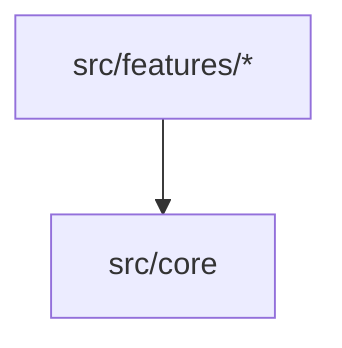

# ARCHITECTURE — dynamic-web-architect

> Governed by **Dynamic Web Architect (DWA v2.0.0)**.
> Source of truth: [`architecture-manifest.json`](./architecture-manifest.json) · Checksum: `e5baa96efd90`

## 1. Architectural Profile

| Dimension | Value |
| :--- | :--- |
| **Pattern** | `feature-driven-screaming` |
| **Complexity Level** | `high` |
| **Framework / Stack** | `node-backend` (`javascript`) |
| **Routing Shell** | Disabled / Not applicable |
| **Security Profile** | `standard`  |
| **AI SDK Boundary** | None declared |
| **Max Loose Files / Dir** | `10` |
| **Promotion Threshold** | `>= 2` consumer modules |

## 2. Unidirectional Dependency Graph (DAG)

| Layer | Allowed Outbound Imports |
| :--- | :--- |
| `src/core` | `none` |
| `src/features/*` | `src/core` |

## 3. Structural Boundaries

| Boundary Role | Canonical Path |
| :--- | :--- |
| `domainModules` | `src/features` |
| `coreInfrastructure` | `src/core` |

## 4. Active Domain Features

- `auditing`
- `evolution`
- `routing`
- `scaffolding`

## 5. Naming & Barrel File Governance

- **Directories**: kebab-case (e.g., user-profile/, billing-history/)
- **Components**: PascalCase (e.g., UserCard.tsx, PaymentModal.vue)
- **Hooks**: camelCase with mandatory use prefix (e.g., useAuthSession.ts)
- **Services**: kebab-case with .service.<ext> or .api.<ext> suffix (e.g., checkout.service.ts)
- **Use Cases**: kebab-case with .use-case.<ext> suffix (e.g., process-payment.use-case.ts)
- **Schemas**: kebab-case with .schema.<ext> suffix (e.g., order.schema.ts)
- **Types**: kebab-case with .types.<ext> suffix (e.g., customer.types.ts)
- **Utilities**: kebab-case with .util.<ext> suffix (e.g., format-currency.util.ts)
- **Tests**: co-located *.test.<ext> or *.spec.<ext> next to subject under test
- **Barrel Policy (`feature-public-api-only`)**:
  - Allowed: `src/features/*/index.cjs`
  - Forbidden: `src/core/index.*`
- **Path Aliases**: Language native

## 6. Dynamic File Placement Rules

1. **Co-location First**: Place files belonging to one business domain inside its feature/module folder.
2. **Shared Coupling Promotion**: Never import internal files across sibling features. When `>= 2` modules need a resource, promote it via `/dynamic-web-architect promote <path>` (or `dwa promote <path>`) to `shared` or `core`.
3. **No Dumping Grounds**: Never create `helpers/`, `misc/`, `common/`, or `temp/`.
4. **Density Guardrail**: Subdivide any directory exceeding `10` loose files into cohesive subdirectories.

## 7. Evolutionary Migration Triggers

- **Next Pattern Candidate**: `monorepo-workspaces`
- Add standalone VS Code extension or web visualizer app alongside CLI engine

<!-- DWA:CUSTOM_NOTES_START -->
## Project-Specific Architecture Decision Notes (ADRs)

- Record custom exceptions or approved ADRs below this marker; `dwa sync` preserves this section verbatim.
