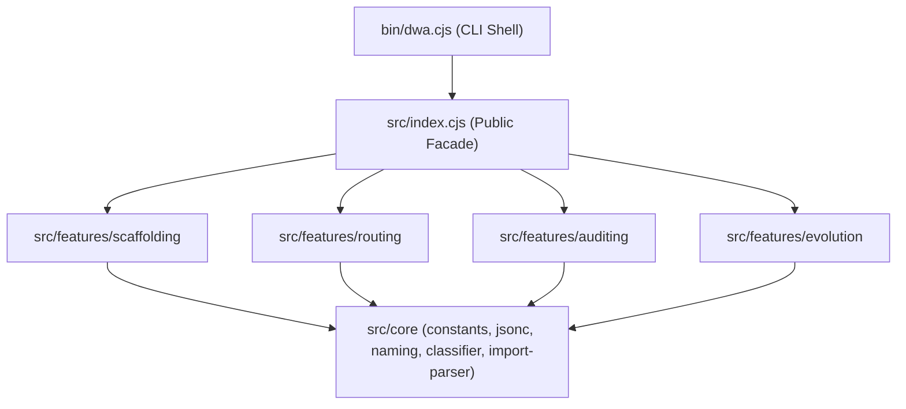

# Especificación Técnica Completa: Dynamic Web Architect (DWA v2.0)

## 1. Propósito, Alcance y Valor Estratégico

**Dynamic Web Architect (DWA)** es un motor determinista de decisión arquitectónica, generador de scaffolding, enrutador dinámico de archivos y auditor estructural (linter DAG) para proyectos web modernos, diseñado como una **Skill + Plugin + CLI cero-dependencias** utilizable en **Antigravity, OpenAI Codex, ChatGPT y Visual Studio Code** mediante el comando `/dynamic-web-architect` o activación automática contextual.

Resuelve cuatro problemas crónicos del desarrollo asistido por IA y equipos humanos:
1. **Caos estructural inicial y sobre-ingeniería**: Evita tanto la creación improvisada de carpetas sin fronteras como la sobre-arquitectura de micrositios simples.
2. **Deriva durante el crecimiento del proyecto**: Responde de forma determinista dónde ubicar cada nuevo componente, hook, servicio, esquema o adaptador (`place-file`) y cuándo promover activos compartidos (`promote`) sin romper importaciones.
3. **Erosión silenciosa de fronteras y regresiones de bundlers**: Detecta dependencias circulares, imports cruzados ilegales entre features, barriles internos que rompen *tree-shaking* o contaminan Server Components en Next.js con `"use client"`, carpetas saturadas (`>10` archivos sueltos) y fuga de SDKs de servidor/IA (`@google/genai`, `pg`, `prisma`, `stripe`) hacia el cliente.
4. **Fragmentación entre plataformas de IA**: Unifica las mismas reglas, esquema `architecture-manifest.json` (JSON Schema Draft 2020-12) y CLI reproducible en Node.js (`>= 18`, 0 dependencias de producción) para Antigravity, Codex, ChatGPT y VS Code.

---

## 2. Arquitectura Interna del Sistema (Dogfooding Feature-Driven)

DWA aplica sobre su propio código el patrón `feature-driven-screaming` con DAG unidireccional estricto:

### Componentes Nucleares
- **`src/core/classifier.cjs`**: Motor de puntuación en **6 ejes** (`presentation`, `domainComplexity`, `dataAndState`, `securityAndCompliance`, `multiAppScale`, `backendAutonomy`), extractor bilingüe (ES/EN) de sustantivos de negocio (*Screaming Check*), detector de **14 frameworks/stacks**, detector de perfiles verticales regulados (`healthcare`, `fintech`, `ecommerce`, `saas`) y detector de SDKs de IA (`@google/genai`, `openai`, `ai`).
- **`src/core/jsonc.cjs`**: Parser JSONC libre de dependencias que limpia comentarios `//`, bloques `/* */` y comas finales sin corromper URLs ni cadenas literales, garantizando lectura fiable de `tsconfig.json` y `jsconfig.json`.
- **`src/core/naming.cjs`**: Normalizador y validador de convenciones (`kebab-case` para directorios, `PascalCase` para componentes UI, `useCamelCase` para hooks, sufijos semánticos `.service`, `.api`, `.use-case`, `.schema`, `.types`, `.util`, `.store`, `.controller`, `.repository`, `.entity`, `.dto`, `.test`).
- **`src/core/import-parser.cjs`**: Extractor estático de imports ESM/CJS/dinámicos/re-exports, resolvedor de rutas relativas y aliases `@/*`, y detector de directivas `"use client"`.
- **`src/features/scaffolding/`**: Generación de `architecture-manifest.json` (con checksum SHA-256), `ARCHITECTURE.md` (con diagrama Mermaid DAG y preservación de notas ADR bajo `<!-- DWA:CUSTOM_NOTES_START -->`), árbol ASCII y scripts reproducibles PowerShell + Bash.
- **`src/features/routing/`**: Enrutador `place-file` y promotor `promote` con reescritura automática de imports (consumidores + imports internos del archivo movido) y vista previa segura `dry-run` por defecto.
- **`src/features/auditing/`**: Linter estructural `audit` con detector de ciclos DFS, validación de reglas DAG por capa, pureza de dominio Hexagonal, control de barriles, densidad de archivos sueltos, pureza de Routing Shell, imports relativos profundos (`../../../`) y guardia de seguridad cliente/servidor + SDKs IA deprecados, produciendo un **Health Score (0–100)**.
- **`src/features/evolution/`**: Reconciliador `sync` y planificador evolutivo `migrate` gobernado por el **Guardarraíl de Costo de Transición** (*Valor Estratégico > Costo de Implementación + Riesgo de Migración + Fatiga Operativa*).

---

## 3. Matriz de Patrones Arquitectónicos (6 Patrones Canónicos)

| Patrón | Complejidad | Casos de Uso Óptimos | Estructura Base | Regla DAG Principal |
| :--- | :--- | :--- | :--- | :--- |
| `classic-by-type` | Baja | Landing pages, portfolios, sitios estáticos (HTML/CSS/JS, Astro) | `src/{assets,styles,scripts,pages,components}` | `pages -> components -> scripts/styles` |
| `atomic-design` | Media | Sistemas de diseño, librerías UI, Storybook, Web Components | `src/{tokens,components/{atoms,molecules,organisms,templates},hooks,utils,types}` | `templates -> organisms -> molecules -> atoms -> tokens/utils/hooks` |
| `feature-driven-screaming` | Alta | Web Apps, SaaS, E-Commerce, CRM, ERP, Dashboards (Next.js, React, Vue, Angular, Nuxt, SvelteKit) | `src/{app\|pages\|routes,features/<dom>,shared/{ui,hooks,utils,types},core/{config,api,store,ai,security}}` | `shell -> features/* -> shared/core`; cero imports internos entre features hermanas |
| `hexagonal-clean` | Media–Alta | APIs REST/GraphQL, Microservicios, Workers (Node/TS, Python FastAPI, Go) | `src/` o `internal/` `{domain,application,infrastructure,interfaces,shared}` | `interfaces -> application -> domain`; `domain` 100% libre de frameworks/ORMs |
| `modular-monolith-fullstack` | Alta | Plataformas fullstack / BFF unificadas sin sobrecoste de microservicios | `src/{app,modules/<dom>/{domain,application,ui,api},shared,core}` | `app -> modules/* -> shared/core` |
| `monorepo-workspaces` | Muy Alta | Ecosistemas multi-app (Web + Admin + API + paquetes compartidos; Turborepo/Nx/pnpm) | `apps/{web,admin,api}`, `packages/{ui,domain,config,utils}` | `apps/* -> packages/*`; `packages/utils` sin dependencias internas |

---

## 4. Refinamientos e Innovaciones respecto al Borrador Original

1. **Motor CLI ejecutable y auditable (`bin/dwa.cjs`)**: Las reglas dejan de ser texto declarativo puro para convertirse en validación determinista con código de salida CI/CD (`0` pass, `1` error estructural).
2. **Sexto patrón (`modular-monolith-fullstack`) y detección de 14 stacks**: Cubre BFFs fullstack modernos, Python FastAPI, Go (`internal/`), SvelteKit (`src/routes`), Nuxt, Astro y Angular.
3. **Detector real de dependencias circulares (DFS)** + **Health Score cuantitativo (0–100)**.
4. **Parser JSONC nativo**: Lee `tsconfig.json` / `jsconfig.json` con comentarios y comas finales sin romperse ni requerir dependencias externas.
5. **Protección de fronteras IA / Servidor (`CLIENT_SERVER_LEAK` y `DEPRECATED_AI_SDK`)**: Aísla `@google/genai`, `openai`, `pg`, `prisma` y `stripe` en módulos server-only y detecta imports de SDKs deprecados (`@google/generative-ai`).
6. **Guardarraíl de Costo de Transición (`dwa migrate`)**: Inspirado en IntentOrbit v3.0, evita re-arquitecturas prematuras cuando el refinamiento incremental entrega >=80% del valor con <=20% del riesgo.
7. **Integración ecosistémica no redundante**: Coexiste limpiamente con Knowledge Diagram Engine (exportando Mermaid DAG y respetando mereología workspace/repo/package y metadatos consultivos), Omni Engine V5 (clasificación multi-eje, perfiles verticales regulados y handoff a `ArchitectureSuiteEngine` / `AdaptiveWebEngine`), IntentOrbit y `gemini-api-dev`.
8. **Seguridad operativa (`dry-run` por defecto)**: Ninguna mutación en disco ocurre durante auditorías, clasificaciones o previsualizaciones sin `--apply` o autorización explícita.

---

## 5. Interfaz de Comandos y Contrato de Salida

### Comandos en IDE / Chat (`/dynamic-web-architect`)
- `/dynamic-web-architect init [contexto]` (aliases: `/architect init`, `/scaffold`)
- `/dynamic-web-architect place-file <archivo> [contexto]` (alias: `/place-file`)
- `/dynamic-web-architect promote <ruta>` (alias: `/promote`)
- `/dynamic-web-architect audit [ruta]` (alias: `/audit-arch`)
- `/dynamic-web-architect sync [ruta]` (alias: `/architect sync`)
- `/dynamic-web-architect migrate <patron-destino>`

### Contrato de Verdad Única (`architecture-manifest.json`)
Validado contra `schemas/architecture-manifest.schema.json` (Draft 2020-12), incluye:
- `schemaVersion`, `project`, `pattern`, `complexityLevel`, `complexityScores`
- `stack` (`framework`, `language`, `runtime`, `packageManager`, `aiSdk`)
- `routingShell`, `pathAliases`, `boundaries`, `importRules`
- `namingConventions`, `barrelPolicy`, `securityProfile`
- `maxLooseFilesPerDirectory`, `promotionThreshold`, `activeFeatures`
- `evolution` (`nextRecommendedPattern`, `migrationTriggers`)
- `metadata` (`generatedBy`, `createdAt`, `updatedAt`, `manifestChecksum` SHA-256, `lastHealthScore`)

---

## 6. Distribución y Compatibilidad Multiplataforma

| Plataforma | Mecanismo de Carga | Activación |
| :--- | :--- | :--- |
| **Antigravity** | `plugin.json` + `skills/dynamic-web-architect/SKILL.md` + `rules/AGENTS.md` | `/dynamic-web-architect` o automática |
| **Codex** | `.codex-plugin/plugin.json` + `skills/dynamic-web-architect/SKILL.md` | `$dynamic-web-architect`, `@dynamic-web-architect`, `/dynamic-web-architect` |
| **ChatGPT** | `.codex-plugin/plugin.json` + `portable-adapters/chatgpt/GPT_INSTRUCTIONS.md` | `/dynamic-web-architect` o lenguaje natural |
| **VS Code** | `.github/prompts/dynamic-web-architect.prompt.md` + `.github/instructions/dynamic-web-architect.instructions.md` + `tasks.template.json` | `/dynamic-web-architect` en Copilot Chat + gobernanza automática en `src/**` |
