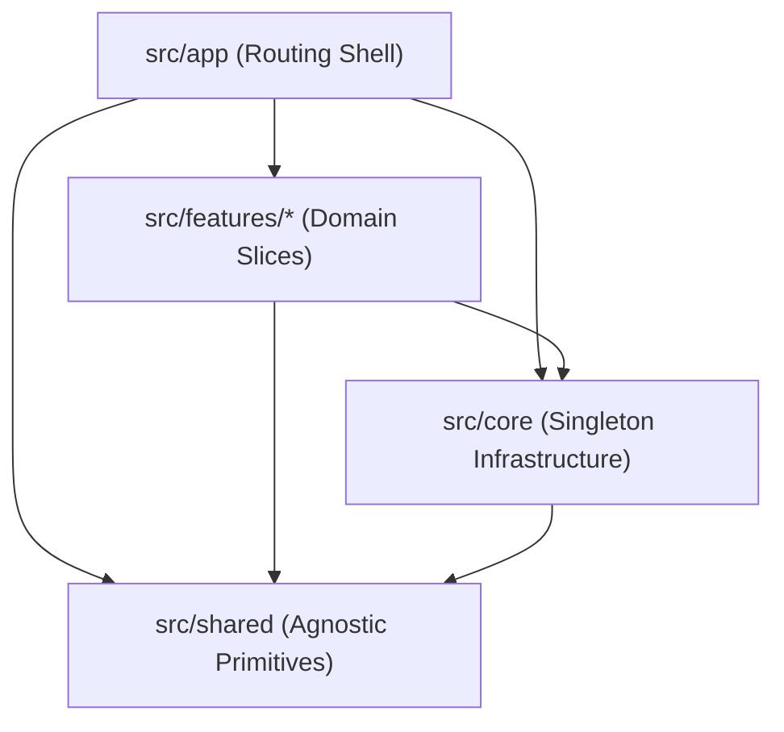

# Naming Governance, Controlled Barrels, JSONC Aliases & DAG Laws

## 1. Strict Naming Conventions

| Artifact Category | Convention | Valid Examples | Anti-Patterns (Flagged) |
| :--- | :--- | :--- | :--- |
| Directories | `kebab-case` (framework dynamic routes `[id]`, `(group)`, `@slot` allowed) | `user-profile/`, `billing-history/` | `UserProfile/`, `billing_history/` |
| UI Components | `PascalCase` (complex sub-components grouped in `kebab-case/` dir) | `OrderSummaryCard.tsx`, `PaymentModal.vue` | `order-summary.tsx`, `userCard.tsx` |
| UI / State Hooks | `camelCase` starting with `use` | `useAuthSession.ts`, `useCartTotals.ts` | `authHook.ts`, `use-cart.ts` |
| Services / APIs | `kebab-case` + `.service.<ext>` or `.api.<ext>` | `checkout.service.ts`, `patients.api.ts` | `CheckoutService.ts`, `checkout.ts` |
| Use Cases | `kebab-case` + `.use-case.<ext>` | `process-payment.use-case.ts` | `ProcessPayment.ts` |
| Schemas / Validation | `kebab-case` + `.schema.<ext>` | `order.schema.ts` | `orderValidation.ts` |
| Types / Interfaces | `kebab-case` + `.types.<ext>` | `customer.types.ts` | `ICustomer.ts` |
| Pure Utilities | `kebab-case` + `.util.<ext>` | `format-currency.util.ts` | `helpers.ts`, `miscUtils.ts` |
| Tests | Co-located `*.test.<ext>` or `*.spec.<ext>` | `OrderSummaryCard.test.tsx` | Distant mirrored `/tests` losing locality |
| Forbidden Generic Dirs | Never create | *(Use `src/shared/utils/` or owning feature)* | `helpers/`, `misc/`, `common/`, `temp/`, `stuff/` |

---

## 2. Unidirectional DAG Dependency Laws



1. **Downward Only**: `shared` imports NOTHING internal (`["none"]`). `core` may import `shared`, never `features` or `app`.
2. **No Sibling Reach-In**: `src/features/orders/*` MUST NEVER import `src/features/billing/components/PriceBadge.tsx`. Either promote `PriceBadge.tsx` to `src/shared/ui/` (via `dwa promote`) or explicitly expose a narrow domain contract through `src/features/billing/index.ts`.
3. **Zero Cycles**: Circular dependencies (`A -> B -> A`) are always `ERROR` findings in `dwa audit`.
4. **Hexagonal Purity**: `domain/` never imports HTTP frameworks, ORMs, UI frameworks, or external vendor SDKs.

---

## 3. Controlled Barrel File Discipline

Modern bundlers (Vite, Turbopack, Webpack, Rollup) and React Server Components suffer severe regressions from indiscriminate `index.ts` re-export barrels:
- **Allowed**: Feature root public API (`src/features/<domain>/index.ts`) and Monorepo package entrypoints (`packages/<pkg>/src/index.ts`).
- **Forbidden**: Internal UI barrels (`src/shared/ui/index.ts`, `src/features/*/components/index.ts`, `src/components/atoms/index.ts`).
- **Why**: A single `"use client"` component exported from `src/shared/ui/index.ts` can taint Server Components importing an unrelated pure component, and forces bundlers to parse hundreds of modules per page. Always import primitives directly: `import { Button } from '@/shared/ui/Button'`.

---

## 4. JSONC Path Aliases (`@/*`)

`tsconfig.json` and `jsconfig.json` are **JSONC** (JSON with comments and trailing commas). DWA parses them with a dedicated JSONC parser and requires `@/* -> ./src/*`:

```jsonc
{
  "compilerOptions": {
    // Eliminate fragile ../../../ relative chains during dynamic promotions
    "paths": {
      "@/*": ["./src/*"]
    }
  }
}
```

Any relative import traversing 3 or more levels up (`../../../...`) is flagged as `DEEP_RELATIVE_IMPORT`.

---

## 5. Server-Only & AI SDK Security Boundaries

When scaffolding or auditing projects using AI SDKs or backend infrastructure:
- **Server-Only Isolation**: Place Gemini (`@google/genai` >= 3.2.0), OpenAI (`openai`), database drivers (`pg`, `prisma`, `drizzle-orm`, `mongoose`), and secret payment clients (`stripe`) exclusively inside `src/core/ai/`, `src/core/db/`, or `src/infrastructure/`.
- **Client Leakage Block (`CLIENT_SERVER_LEAK`)**: Files starting with `"use client"` must NEVER import server-only packages.
- **Modern Gemini SDK Guard (`DEPRECATED_AI_SDK`)**: Flag deprecated `@google/generative-ai` / `google-generativeai` packages and recommend `@google/genai` (`>= 3.2.0`) targeting current Gemini models (`gemini-4-hydrogen`, `gemini-4-argon`, `gemini-4-carbon`, `gemini-decision-1`).
